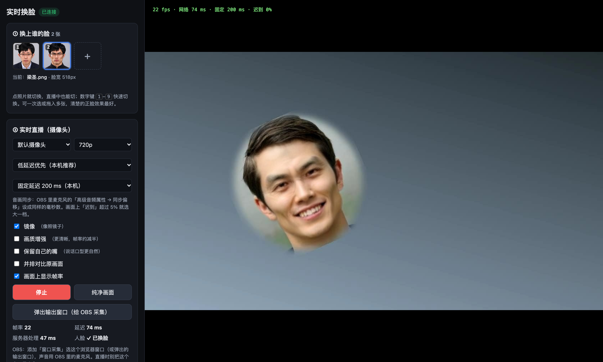

# deep-live-cam-web

一张照片，实时换脸直播的网页工作台。基于开源项目 [Deep-Live-Cam](https://github.com/hacksider/Deep-Live-Cam)：上传照片，打开摄像头，画面里的脸实时换成照片里的人，弹出窗口直接给 OBS 采集。

能跑在两种机器上：

- **Apple 芯片的 Mac**：本机跑，CoreML 加速，不用显卡，画面不出电脑。M5 实测 720p 21 fps。
- **带 NVIDIA 显卡的 Linux 服务器**：CUDA 加速，笔记本远程连过去用。RTX 4090 每帧 17–22 ms，远程 720p 24–27 fps（网络好时）。



<sub>截图里的梁子、梁圣是虚拟人物。</sub>

## 能做什么

- **照片库**：一次放多张照片，直播中点缩略图或按数字键 1–9 切换，下一帧就换好
- **实时直播**：浏览器开摄像头，画面经 WebSocket 发给服务，换好传回来；弹出一个只有换脸画面的窗口，给 OBS「窗口采集」
- **两种网络模式**：低延迟优先（本机）、流畅优先（远程，允许多帧同时在路上，远程 720p 从 11 提到 27 fps）
- **画面固定延迟**：每帧在拍摄后固定的毫秒数显示，OBS 给麦克风设同样的偏移，口型就对上
- **可选**：保留自己的嘴（说话更自然）、画质增强（更清晰，帧率约减半，需要 `--with-enhancer`）、并排对比原画面
- **视频换脸**：上传一段视频，后台用 Deep-Live-Cam 自带的命令行处理，网页看进度、下载结果

| 文件 | 干什么 |
|---|---|
| `install.sh` | 安装：Python 3.12、Deep-Live-Cam、依赖、模型，全部装在这个文件夹里 |
| `start.sh` | 启动 / 停止 / 看日志。`start.command` 是 Mac 上双击用的 |
| `remote.sh` | 远程显卡服务器：在服务器上启动服务，本机开 SSH 隧道，打开网页 |
| `web_server.py` | 服务端（aiohttp），只监听 127.0.0.1 |
| `index.html` | 网页 |
| `bench.py` | 测速：用一段视频冒充摄像头，统计帧率和延迟 |
| `uninstall.sh` | 卸载 |

## 安装

前提：Apple 芯片的 Mac，或带 NVIDIA 显卡（驱动已装）的 Linux；有 `git`、`curl`、`python3`（任意版本，只用来装 [uv](https://github.com/astral-sh/uv)）。

```bash
git clone https://github.com/limin112/min-skill.git
cd min-skill/tools/deep-live-cam-web
./install.sh
```

安装器做的事：

1. 用 uv 在这个文件夹里装一份 Python 3.12（`.python/`、`.venv/`），不动系统 Python
2. 克隆 Deep-Live-Cam 到 `Deep-Live-Cam/`，切到实测过的提交 `08896a5`
3. 装依赖。Mac 上会装带 CoreML 的 onnxruntime；Linux 上会把冲突的 OpenCV 换成 headless 版，并装 CUDA 版 torch（顺带装上 onnxruntime-gpu 需要的 cuDNN 等库）
4. 下载模型：换脸模型 `inswapper_128_fp16.onnx`（265 MB）到 `Deep-Live-Cam/models/`，人脸检测 `buffalo_l`（330 MB）到 `~/.insightface/models/`

Mac 上整套约 2 GB，Linux 加上 torch 会更大。卸载：`./uninstall.sh`（照片和视频保留），`./uninstall.sh --all` 全部删掉。

```bash
./install.sh --with-enhancer                        # 额外下载画质增强模型（350 MB）
HF_ENDPOINT=https://hf-mirror.com ./install.sh      # 国内网络，模型走镜像
```

视频换脸要用 `ffmpeg`，需要的话自己装一个放进 PATH；实时直播用不到。

## 使用

### 在这台电脑上跑（Mac 推荐）

```bash
./start.sh          # Mac 也可以双击 start.command
```

会在后台启动服务，用 Chrome 打开 http://localhost:8765。然后：

1. 把照片拖进左侧照片库
2. 「网络模式」选 **低延迟优先（本机推荐）**，分辨率 720p
3. 点「开始」，允许使用摄像头
4. 点「弹出输出窗口」，OBS 里加「窗口采集」选它
5. 「固定延迟」选 **200 ms**，OBS 里麦克风「高级音频属性 → 同步偏移」也填 200

```bash
./start.sh status   # 在不在跑
./start.sh log      # 看日志
./start.sh stop     # 停止；不管它的话闲置 2 小时自动退出
```

### 用远程显卡服务器

先在服务器上 clone 本仓库并运行 `./install.sh`。然后在笔记本上：

```bash
./remote.sh 你的服务器                                # ssh 能连上的名字，或 user@ip
./remote.sh 你的服务器 ~/apps/min-skill/tools/deep-live-cam-web   # 服务器上的目录不是默认位置时
GPU=1 ./remote.sh 你的服务器                          # 换一张卡
```

它会在服务器上启动服务、在本机开一条 `ssh -L 8765:127.0.0.1:8765` 隧道、打开 http://localhost:8765。浏览器只允许在 localhost 或 https 下用摄像头，所以要走隧道，别直接开服务器 IP。

远程时「网络模式」选 **流畅优先**，固定延迟选 350–450 ms（「迟到」超过 5% 就选大一档）。720p 每个方向要 8 Mbps 左右，网络一般就用 480p。

## 实测

| | Mac 本机（M5，24 GB） | Linux + RTX 4090 |
|---|---|---|
| 每帧处理 | 45 ms | 17–22 ms |
| 直播帧率 | 720p 21 fps | 远程 720p 24–27 fps |
| 画面延迟 | 62–91 ms（不开固定延迟） | 再加网络往返 |
| 推荐设置 | 低延迟优先 + 固定 200 ms | 流畅优先 + 固定 350–450 ms |

自己测：先在网页里选好照片，然后

```bash
.venv/bin/python bench.py 任意视频.mp4                                     # 低延迟优先
.venv/bin/python bench.py 任意视频.mp4 --inflight 8 --jpeg-q 75 --srv-q 75   # 流畅优先
```

服务同一时间只服务一个直播连接，测速会把网页上正在进行的直播挤掉。

## 常见问题

**Mac 启动时日志刷一大串 `E5RT … unbounded dimension`、`ANECompiler FAILED`。**
人脸检测模型有一部分放不进 Apple 的神经网络引擎，自动退回 GPU / CPU 算，不影响使用，上面的数据就是在这种情况下测的。

**Mac 上「流畅优先」没有更快。**
本机的瓶颈是芯片本身（45 ms 一帧，上限 22 fps），多帧同时在路上只会让延迟从 88 涨到 128 ms。本机用低延迟优先。

**Linux 上很慢，像在用 CPU。**
onnxruntime-gpu 找不到 cuDNN 会悄悄退回 CPU。`start.sh` 会把 `.venv` 里 pip 装的 NVIDIA 库加进 `LD_LIBRARY_PATH`；自己用别的方式启动时也要加。`./start.sh log` 里 `ready on` 那一行的 `provider=` 应该是 `cuda`。

**Linux 无界面服务器上报 libGL、Qt 相关的错。**
Deep-Live-Cam 即使不开界面也会加载 PySide6。`start.sh` 已经设了 `QT_QPA_PLATFORM=offscreen`；缺系统库就装上，比如 Ubuntu：`sudo apt install libgl1 libglib2.0-0`。

**像不像？**
它只换眉眼、鼻子和嘴，发型、脸型、眼镜和表情都是镜头前的人的。想更像，戴接近的发型、照着照片穿；灯光用正面柔光；转头控制在 45° 以内，别用手挡嘴。

## 请负责任地使用

- 只用 AI 生成的形象、你自己，或已经拿到本人同意的照片
- 直播间注明「AI 生成 / 虚拟形象」
- 不用来冒充他人、诈骗或绕过人脸认证

## 许可

本工具的代码按 [AGPL-3.0](LICENSE) 发布（它直接调用 Deep-Live-Cam 的模块，与上游保持一致）。Deep-Live-Cam 和模型不随本仓库分发，由 `install.sh` 从上游下载；`inswapper` 和 `buffalo_l` 模型来自 InsightFace，仅限非商业研究用途，使用前请看上游的许可说明。
